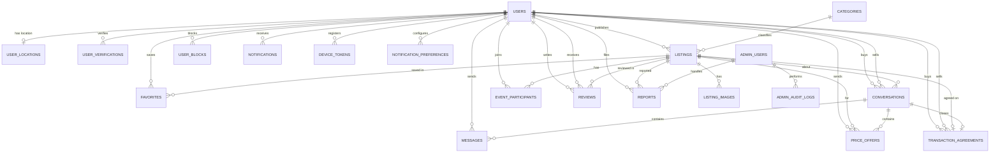

# C2C Nearby — Database Design (MySQL 8.0+ / Sequelize v6)

Verified target: MySQL 9.4 (Homebrew, macOS). All objects are created by migrations, never by
model synchronization. InnoDB + utf8mb4 + `utf8mb4_0900_ai_ci` collation.

## 1. Conventions

| Concern | Rule |
| --- | --- |
| Table names | plural `snake_case`, `freezeTableName: true`, no pluralization |
| Primary key | `id` `CHAR(36)` (UUID v4), `BINARY(16)` is not used anywhere |
| Timestamps | `created_at`, `updated_at` `DATETIME(3)` in UTC |
| Soft delete | `deleted_at` `DATETIME(3)` only where retention requires history (`users`, `listings`) |
| Foreign keys | `<singular_table>_id`, explicit, created **only** in migrations |
| Money | `DECIMAL(15,2)`, never `FLOAT`/`DOUBLE` |
| Booleans | `TINYINT(1)` |
| Enums | native MySQL `ENUM`, mirrored as TS union types |
| JSON | only free-form metadata (`admin_audit_logs.metadata`, `app_settings.value`) |
| Coordinates | `POINT SRID 4326`, axis order **(longitude, latitude)** — MySQL stores x=longitude, y=latitude; read back with `ST_Latitude()` / `ST_Longitude()` |
| FK actions | explicit `ON DELETE`/`ON UPDATE`; `CASCADE` only for child content that has no meaning without its parent |

Sequelize model options: `underscored: true`, `timestamps: true`, `freezeTableName: true`,
`charset: 'utf8mb4'`, `collate: 'utf8mb4_0900_ai_ci'`.

## 2. ERD



## 3. Tables

### 3.1 users

| Column | Type | Rules |
| --- | --- | --- |
| id | CHAR(36) | PK |
| firebase_uid | VARCHAR(128) | NOT NULL, UNIQUE |
| username | VARCHAR(30) | NOT NULL, UNIQUE, lowercase `^[a-z0-9._]{3,30}$` |
| display_name | VARCHAR(100) | NULL |
| full_name | VARCHAR(120) | NULL, private |
| avatar_url | VARCHAR(500) | NULL |
| bio | VARCHAR(280) | NULL |
| area_label | VARCHAR(120) | NULL, public coarse area |
| phone_private | VARCHAR(20) | NULL, E.164, private |
| phone_verified | TINYINT(1) | NOT NULL DEFAULT 0 |
| face_verification_status | ENUM(unverified,pending,verified,rejected) | NOT NULL DEFAULT unverified |
| profile_completed | TINYINT(1) | NOT NULL DEFAULT 0 |
| account_status | ENUM(active,suspended,deactivated) | NOT NULL DEFAULT active |
| last_active_at | DATETIME(3) | NULL |
| created_at / updated_at | DATETIME(3) | NOT NULL |
| deleted_at | DATETIME(3) | NULL, soft delete |

Indexes: `uq_users_firebase_uid`, `uq_users_username`, `idx_users_status (account_status, deleted_at)`,
`idx_users_last_active (last_active_at)`.
`phone_private` is never selected by profile/list queries; dedicated service-gated repository
methods only.

### 3.2 user_locations

| Column | Type | Rules |
| --- | --- | --- |
| id | CHAR(36) | PK |
| user_id | CHAR(36) | NOT NULL, UNIQUE, FK users(id) ON DELETE CASCADE |
| location_private | POINT SRID 4326 | NOT NULL, private |
| area_label | VARCHAR(120) | NULL |
| location_updated_at | DATETIME(3) | NOT NULL |
| created_at / updated_at | DATETIME(3) | NOT NULL |

`SPATIAL INDEX idx_user_locations_point (location_private)` (MySQL requires NOT NULL).

### 3.3 user_verifications

| Column | Type | Rules |
| --- | --- | --- |
| id | CHAR(36) | PK |
| user_id | CHAR(36) | NOT NULL, FK users(id) ON DELETE CASCADE |
| verification_type | ENUM(phone,face,email) | NOT NULL |
| provider | VARCHAR(50) | NOT NULL (`firebase`, `mock`, provider slug) |
| provider_reference | VARCHAR(190) | NULL |
| status | ENUM(pending,verified,rejected,expired) | NOT NULL DEFAULT pending |
| verified_at | DATETIME(3) | NULL |
| expires_at | DATETIME(3) | NULL |
| created_at / updated_at | DATETIME(3) | NOT NULL |

Indexes: `idx_user_verifications_user (user_id, verification_type, status)`,
`idx_user_verifications_ref (provider, provider_reference)`.
Biometric assets are never stored here; only provider references and status.

### 3.4 categories

| Column | Type | Rules |
| --- | --- | --- |
| id | CHAR(36) | PK |
| name | VARCHAR(80) | NOT NULL |
| slug | VARCHAR(80) | NOT NULL, UNIQUE |
| post_type | ENUM(sell,event,information) | NOT NULL |
| icon | VARCHAR(80) | NULL |
| image_url | VARCHAR(500) | NULL |
| is_active | TINYINT(1) | NOT NULL DEFAULT 1 |
| sort_order | INT | NOT NULL DEFAULT 0 |
| created_at / updated_at | DATETIME(3) | NOT NULL |

Index: `idx_categories_listing (post_type, is_active, sort_order)`.

### 3.5 listings

One table for the three post types; type-specific columns are nullable and validated per type by
the service layer and CHECK constraints where safe.

| Column | Type | Rules |
| --- | --- | --- |
| id | CHAR(36) | PK |
| user_id | CHAR(36) | NOT NULL, FK users(id) ON DELETE RESTRICT |
| post_type | ENUM(sell,event,information) | NOT NULL |
| category_id | CHAR(36) | NULL, FK categories(id) ON DELETE SET NULL |
| title | VARCHAR(150) | NOT NULL |
| slug | VARCHAR(190) | NOT NULL, UNIQUE |
| description | TEXT | NOT NULL |
| price | DECIMAL(15,2) | NULL (sell) |
| price_type | ENUM(fixed,negotiable) | NULL (sell) |
| condition | ENUM(new,used) | NULL (sell) |
| brand | VARCHAR(80) | NULL (sell) |
| location_private | POINT SRID 4326 | NOT NULL, private |
| location_public_label | VARCHAR(150) | NOT NULL, coarse area only |
| event_start / event_end | DATETIME(3) | NULL (event) |
| event_location_public | VARCHAR(255) | NULL (event) |
| event_is_free | TINYINT(1) | NULL (event) |
| event_link | VARCHAR(500) | NULL (event) |
| information_link | VARCHAR(500) | NULL (information) |
| status | ENUM(draft,active,hidden,sold,completed,rejected,expired) | NOT NULL DEFAULT draft |
| published_at | DATETIME(3) | NULL |
| expires_at | DATETIME(3) | NULL |
| created_at / updated_at | DATETIME(3) | NOT NULL |
| deleted_at | DATETIME(3) | NULL |

Indexes (documented by query):
- `SPATIAL idx_listings_point (location_private)` — radius candidate lookup.
- `uq_listings_slug` — public detail URL.
- `idx_listings_feed (status, post_type, published_at)` — feed filtering + ordering.
- `idx_listings_category (category_id, status, published_at)` — category tab.
- `idx_listings_user (user_id, status, created_at)` — "Posting Saya".
- `idx_listings_expiry (status, expires_at)` — expiry job.
- `idx_listings_event (post_type, event_start)` — upcoming event reminders.

CHECKs: `price IS NULL OR price >= 0`; `rating`-like checks are on their own tables.
`post_type='sell'` requires price/condition; enforced in service + migration CHECK for price
presence is omitted because information posts legitimately have NULL price.

### 3.6 listing_images

| Column | Type | Rules |
| --- | --- | --- |
| id | CHAR(36) | PK |
| listing_id | CHAR(36) | NOT NULL, FK listings(id) ON DELETE CASCADE |
| image_url | VARCHAR(500) | NOT NULL |
| thumbnail_url | VARCHAR(500) | NOT NULL |
| width / height | INT UNSIGNED | NULL |
| sort_order | INT | NOT NULL DEFAULT 0 |
| created_at | DATETIME(3) | NOT NULL |

Index: `idx_listing_images_listing (listing_id, sort_order)`.

### 3.7 favorites

`id`, `user_id` FK users CASCADE, `listing_id` FK listings CASCADE, `created_at`.
`UNIQUE uq_favorites_user_listing (user_id, listing_id)`, `idx_favorites_listing (listing_id)`.

### 3.8 conversations

| Column | Type | Rules |
| --- | --- | --- |
| id | CHAR(36) | PK |
| listing_id | CHAR(36) | NOT NULL, FK listings(id) ON DELETE CASCADE |
| buyer_id | CHAR(36) | NOT NULL, FK users(id) ON DELETE CASCADE |
| seller_id | CHAR(36) | NOT NULL, FK users(id) ON DELETE CASCADE |
| last_message_at | DATETIME(3) | NULL |
| last_message_preview | VARCHAR(200) | NULL (denormalised for chat list; server-written) |
| created_at / updated_at | DATETIME(3) | NOT NULL |

`UNIQUE uq_conversations_thread (listing_id, buyer_id, seller_id)`,
`idx_conversations_buyer (buyer_id, last_message_at)`,
`idx_conversations_seller (seller_id, last_message_at)`. `buyer_id <> seller_id` is enforced in
the service layer: MySQL rejects CHECK on columns that also carry a cascading FK (error 3823).

### 3.9 messages

`id`, `conversation_id` FK CASCADE, `sender_id` FK users RESTRICT,
`message_type ENUM(text,image,offer,meetup,system)`, `content TEXT NULL`,
`media_url VARCHAR(500) NULL`, `created_at`, `read_at DATETIME(3) NULL`.
Indexes: `idx_messages_thread (conversation_id, created_at)`, `idx_messages_sender (sender_id)`,
`idx_messages_unread (conversation_id, read_at)`.

### 3.10 price_offers

`id`, `conversation_id` FK CASCADE, `listing_id` FK CASCADE, `sender_id` FK users RESTRICT,
`receiver_id` FK users RESTRICT, `offered_price DECIMAL(15,2) NOT NULL`,
`status ENUM(pending,accepted,rejected,withdrawn,expired) DEFAULT pending`,
`created_at`, `updated_at`, `expires_at DATETIME(3) NULL`.
Indexes: `idx_offers_thread (conversation_id, created_at)`,
`idx_offers_listing_status (listing_id, status)`, `idx_offers_expiry (status, expires_at)`;
CHECK `offered_price > 0`. `sender_id <> receiver_id` is enforced in the service layer.

### 3.11 transaction_agreements

| Column | Type | Rules |
| --- | --- | --- |
| id | CHAR(36) | PK |
| listing_id | CHAR(36) | NOT NULL, FK listings(id) ON DELETE RESTRICT |
| conversation_id | CHAR(36) | NOT NULL, UNIQUE, FK conversations(id) ON DELETE RESTRICT |
| buyer_id / seller_id | CHAR(36) | NOT NULL, FK users RESTRICT |
| agreed_price | DECIMAL(15,2) | NOT NULL |
| meetup_location_public | VARCHAR(255) | NULL |
| meetup_at | DATETIME(3) | NULL |
| buyer_confirmation / seller_confirmation | TINYINT(1) | NOT NULL DEFAULT 0 |
| status | ENUM(negotiating,agreed,meetup_scheduled,completed,cancelled,disputed) | NOT NULL DEFAULT negotiating |
| completed_at | DATETIME(3) | NULL |
| created_at / updated_at | DATETIME(3) | NOT NULL |

Indexes: `uq_agreements_conversation`, `idx_agreements_listing (listing_id, status)`,
`idx_agreements_buyer (buyer_id, status)`, `idx_agreements_seller (seller_id, status)`.
`buyer_id <> seller_id` is enforced in the service layer.

### 3.12 event_participants

`id`, `event_listing_id` FK listings CASCADE, `user_id` FK users CASCADE,
`status ENUM(interested,going,cancelled) DEFAULT interested`, `created_at`, `updated_at`.
`UNIQUE uq_event_participants (event_listing_id, user_id)`, `idx_event_participants_user (user_id)`.

### 3.13 reviews

`id`, `listing_id` FK listings CASCADE, `reviewer_id` FK users RESTRICT, `reviewee_id` FK users
RESTRICT, `rating TINYINT UNSIGNED NOT NULL`, `review VARCHAR(1000) NULL`, `created_at`,
`updated_at`.
`UNIQUE uq_reviews_listing_reviewer (listing_id, reviewer_id)`,
`idx_reviews_reviewee (reviewee_id, created_at)`, CHECK `rating BETWEEN 1 AND 5`.
`reviewer_id <> reviewee_id` is enforced in the service layer.

### 3.14 reports

`id`, `reporter_id` FK users CASCADE, `reported_user_id` FK users SET NULL, `listing_id` FK
listings SET NULL, `reason ENUM(spam,fraud,prohibited,harassment,other)`,
`description TEXT NULL`, `status ENUM(open,reviewing,resolved,dismissed) DEFAULT open`,
`resolution_note VARCHAR(500) NULL`, `handled_by_admin_id` FK admin_users SET NULL,
`handled_at DATETIME(3) NULL`, `created_at`, `updated_at`.
Indexes: `idx_reports_status (status, created_at)`, `idx_reports_user (reported_user_id)`,
`idx_reports_listing (listing_id)`.

### 3.15 user_blocks

`id`, `blocker_id` FK users CASCADE, `blocked_id` FK users CASCADE, `created_at`.
`UNIQUE uq_user_blocks (blocker_id, blocked_id)`, `idx_user_blocks_blocked (blocked_id)`.
`blocker_id <> blocked_id` is enforced in the service layer.

### 3.16 notifications

`id`, `user_id` FK users CASCADE, `title VARCHAR(150)`, `body VARCHAR(500)`,
`type VARCHAR(50)`, `reference_id CHAR(36) NULL`, `read_at DATETIME(3) NULL`, `created_at`.
Index: `idx_notifications_user (user_id, read_at, created_at)`, `idx_notifications_reference (type, reference_id)`.

### 3.17 device_tokens

`id`, `user_id` FK users CASCADE, `token VARCHAR(255) NOT NULL UNIQUE`,
`platform ENUM(android,ios,web)`, `last_used_at DATETIME(3)`, `created_at`, `updated_at`.
Index: `idx_device_tokens_user (user_id)`.

### 3.18 notification_preferences

`id`, `user_id` FK users CASCADE, `type VARCHAR(50) NOT NULL`,
`push_enabled TINYINT(1) DEFAULT 1`, `in_app_enabled TINYINT(1) DEFAULT 1`, timestamps.
`UNIQUE uq_notification_pref (user_id, type)`.

### 3.19 admin_users

`id`, `firebase_uid VARCHAR(128) NOT NULL UNIQUE`, `email VARCHAR(190) NULL`,
`role ENUM(super_admin,admin,moderator,verification_manager,support) NOT NULL`,
`is_active TINYINT(1) DEFAULT 1`, `last_login_at DATETIME(3) NULL`, timestamps.
Index: `idx_admin_users_role (role, is_active)`.

### 3.20 admin_audit_logs

`id`, `admin_id CHAR(36) NULL` FK admin_users SET NULL, `action VARCHAR(100) NOT NULL`,
`target_type VARCHAR(50) NOT NULL`, `target_id CHAR(36) NULL`, `metadata JSON NULL`,
`ip_address VARCHAR(45) NULL`, `created_at`.
Indexes: `idx_audit_admin (admin_id, created_at)`, `idx_audit_target (target_type, target_id)`,
`idx_audit_action (action, created_at)`.

### 3.21 app_settings

`id`, `setting_key VARCHAR(100) NOT NULL UNIQUE`, `value JSON NOT NULL`,
`updated_by_admin_id CHAR(36) NULL` FK admin_users SET NULL, timestamps.

## 4. Spatial search design

```sql
SELECT ... ,
       ROUND(ST_Distance_Sphere(l.location_private, ST_SRID(POINT(?, ?), 4326))) AS distance_m
FROM listings l
WHERE l.status = 'active'
  AND l.deleted_at IS NULL
  AND ST_Within(
        l.location_private,
        ST_GeomFromText(
          CONCAT('POLYGON((', ?, ' ', ?, ',', ?, ' ', ?, ',', ?, ' ', ?, ',',
                 ?, ' ', ?, ',', ?, ' ', ?, '))'), 4326)
      )
HAVING distance_m <= 4000
ORDER BY distance_m ASC, l.published_at DESC
LIMIT ? OFFSET ?;
```

- The envelope is computed server-side from `lat ± 0.036` and `lng ± 0.036` (≈4 km, padded at
  the equator and safe for Indonesian latitudes), then exact distance filters to 4,000 m.
- Parameters are always bound; no interpolation of user input.
- Every listing query filters `deleted_at IS NULL` and a visibility status.
- Points are stored and bound as `POINT(longitude, latitude)` (MySQL's axis order for SRID 4326);
  `ST_Latitude()` / `ST_Longitude()` expose the components. Verification on MySQL 9.4:
  `ST_SRID(POINT(106.8, -6.2), 4326)` yields latitude `-6.2` and a 1.57 km `ST_Distance_Sphere`
  to `POINT(106.81, -6.21)`.

## 5. Data integrity

- All FK constraints created in migrations with explicit actions.
- App-level validation never replaces DB constraints; services additionally enforce ownership,
  status transitions, and role permissions.
- Multi-table writes (accepting an offer → agreement, completing a transaction → listing status,
  review eligibility) run in Sequelize transactions (`READ COMMITTED` by default; `SERIALIZABLE`
  for offer acceptance if contention is observed).
- Soft-deleted users/listings remain referenced for audit and chat history.

## 6. Retention summary

| Data | Retention |
| --- | --- |
| Account profile | Until deletion request + 30-day grace |
| Listings | Archived after expiry; hard-deleted 90 days after account deletion |
| Chat messages | 24 months after last activity, then purged |
| Price offers / agreements | 24 months for dispute handling |
| Reports / audit logs | 5 years (legal/audit) |
| Verification provider references | Until verification is superseded + 12 months |
| Raw verification media | Never stored permanently; provider-side only |
| Device tokens | Removed on logout/uninstall detection or 180 days inactivity |
